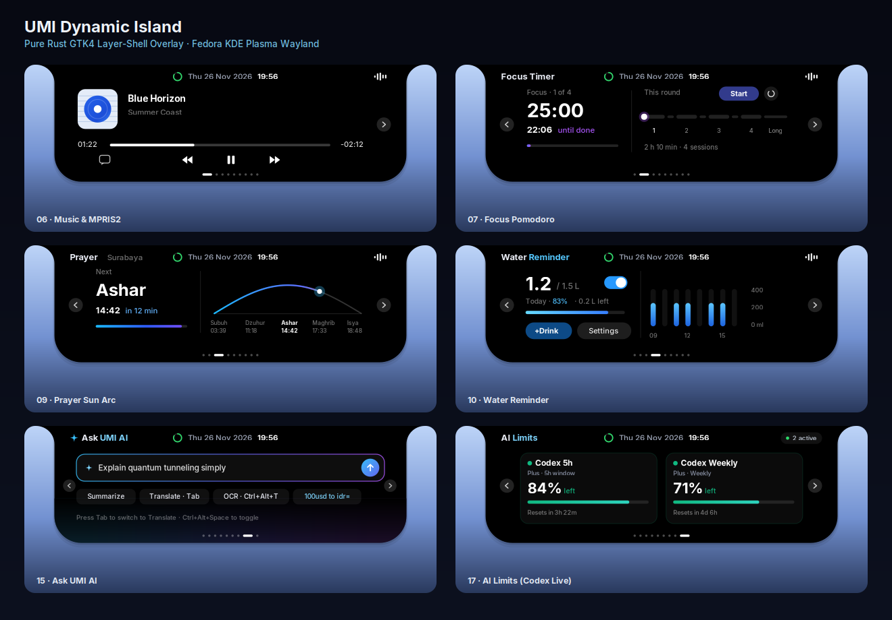
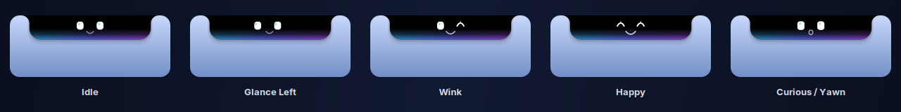

# UMI — Ambient Notch Companion

**UMI** is a lightweight, **Pure Rust** Dynamic Island desktop overlay built for **Linux Wayland** (`gtk4-rs` + `gtk4-layer-shell` + `tokio` + `zbus` + `rusqlite` + `ksni`). It lives cleanly at the top center edge of your screen with smooth VSync animations, concave bezel fillets, click-through Wayland input regions, 18 interactive notch states, expressive procedural mascot animations, and a 7-screen Desktop Settings app.



### Expressive Procedural Mascot (`01 Resting`)
Natural & double-blink, glance left/right-up, playful wink, joyful `^ ◡ ^` smile (also reacts when logging water or completing tasks), curious mini-yawn, and late-night sleepy mode (`23:00–05:00`) — rendered 100% in Cairo with zero extra dependencies or idle CPU overhead.



---

## Platform & Compositor Support

UMI uses the Wayland **`zwlr_layer_shell_v1`** protocol (`gtk4-layer-shell`) and native Linux/KDE D-Bus interfaces.

| Environment | Status | Details |
|---|---|---|
| **Fedora 40–44+ · KDE Plasma 6 (Wayland)** | **Full Support (100%)** | Primary target. All 18 states, MPRIS2, LRCLIB lyrics, UPower, BlueZ, Klipper clipboard, KWallet6 encrypted keys, XDG GlobalShortcuts & Screenshot Portals, SNI tray, and 7-screen Settings work out of the box. |
| **Arch / Ubuntu 24.04+ / openSUSE / NixOS · KDE Plasma 6 (Wayland)** | **Full Support (100%)** | Build from source with `cargo build --release` against local system libraries. |
| **Hyprland / Sway / Niri / River (Wayland `layer-shell`)** | **Partial Support** | Notch overlay, animations, Music + Synced Lyrics, Focus Timer, Prayer Times, Water Reminder, File Shelf DnD, To-do, Widgets, AI Limits (Codex + scripts), and Settings work. **Limitations:** Clipboard history currently reads `org.kde.klipper` and API key encryption uses `org.kde.kwalletd6`. |
| **GNOME (Mutter Wayland)** | **Not Supported** | GNOME Mutter does not implement `zwlr_layer_shell_v1`. |
| **X11 Sessions** | **Not Supported** | Wayland-only (`gtk4-layer-shell`). |

---

## Features

### 18 Interactive Notch States
- **Compact:** `01 Resting` (mascot eyes with blinking & smooth Accent Aura glow) & `02 Closed` (battery ring, clock, live EQ bars; optional Minimal thin-bezel mode).
- **Peek Alerts:** `03 Notification` (passive D-Bus `BecomeMonitor` — non-conflicting with `plasmashell`), `04 Headphones` (BlueZ audio battery), `05 Charging` (UPower AC plug-in), `18 Quota Low` (`< 20%` warning alert).
- **Media & Synced Lyrics:** `06 Music` (MPRIS2 controls + album art for Spotify, YouTube, YouTube Music, VLC, browsers) & `08 Lyrics` (`520×140 dp` wide split-pane with subpixel smooth gliding lyrics, YouTube/YTM title sanitizer, LRCLIB cloud fetch, and SQLite cache).
- **Productivity & Utilities:** `07 Focus Timer` (8-segment Pomodoro timeline), `09 Prayer` (100% offline Kemenag RI / MWL / ISNA / Umm al-Qura astronomy + Sun Arc + BeaconDB Wi-Fi auto-location + Adzan media auto-pause), `10 Water` (hourly bar chart + In-Notch Quick Settings), `11 Shelf` (Wayland Drag-and-Drop URI storage), `12 Clipboard` (Klipper live history), `13 To-do` (inline GTK4 entry + SQLite), `14 Widgets` (2-slot Calendar & Battery).
- **AI & Quotas:** `15/16 Ask UMI AI` (BYOK Gemini / Claude / OpenAI-compatible / Ollama, automatic Gemini model fallback on `404/429/5xx`, local instant Quick Math & Currency `100usd to idr=`, `Tab` Translate mode, Gemini Vision **Smart Screen OCR** via XDG Screenshot Portal) & `17 AI Limits` (real-time Codex 5h & Weekly reader from `~/.codex/sessions/**/*.jsonl` + extensible `ScriptProvider`).

### 7-Screen Desktop Settings Window (`860×604`)
- **General:** Live Notch Preview (`Resting | Closed | Minimal`), `Start at Login` (`~/.config/autostart/umi.desktop`), Idle Mascot Eyes, Minimal Notch Mode, Header Clock, **Hide Behind Fullscreen Apps** (`Layer::Top` vs `Layer::Overlay`), and **Target Display** multi-monitor selector.
- **Appearance:** Smoothly morphing `Attached / Floating / Glass` styles, 6 Accent Aura palettes, Mascot Eye Tint, Glass Blur & Display Scale (`80%–150%`), Concave Fillets, and Spring Speed presets (`Snappy | Balanced | Calm`).
- **Notch Pages:** Enable/disable and reorder all 9 interactive notch pages.
- **Focus & Water:** Pomodoro durations, round count, hydration goal, bottle size, and interval.
- **Prayer Times:** Live 5-prayer daily schedule, Auto Wi-Fi vs Pick City (12 cities), calculation method, pre-prayer nudge, and Adzan auto-pause.
- **AI & Shortcuts:** Provider switcher, direct **KWallet** encrypted API key entry, model selector, tracked AI quota toggles, and global shortcuts reference.
- **About & Data:** Offline SQLite stats, JSON settings export, data folder shortcut, and reset.

### Lightweight Footprint
- Single stripped Pure Rust binary (`~7.1 MB`, `opt-level = "s"`, `lto = "thin"`).
- Defaults to `GSK_RENDERER=cairo` and `1` Tokio worker thread to avoid ~65 MB Vulkan/Mesa driver overhead while keeping VSync `60–144 fps` animations smooth (`~51 MB` RSS / `~20–28 MB` private memory).
- 100% local-first privacy: no account, no telemetry. Config in `~/.config/umi/config.toml`, SQLite in `~/.local/share/umi/umi.db`, API keys encrypted in **KDE Wallet**.

---

## Easy Installation

Download the latest packages directly from [**GitHub Releases**](https://github.com/YuukiWhite/UMI/releases/latest):

### Option 1 — AppImage + Gear Lever (Recommended · Auto-Update)
1. Download **`UMI-*-x86_64.AppImage`** from [GitHub Releases](https://github.com/YuukiWhite/UMI/releases/latest).
2. Open it with **Gear Lever** (or drag it into Gear Lever) and click **Move to the app menu**.
3. **Auto-Update:** Every UMI AppImage embeds official `gh-releases-zsync` update metadata (`UMI-*x86_64.AppImage.zsync`), so Gear Lever automatically detects and updates new releases in 1 click.

### Option 2 — 1-Line Script / Portable `.tar.gz`
```bash
curl -fsSL https://raw.githubusercontent.com/YuukiWhite/UMI/main/scripts/quick-install.sh | bash
```
Or download `UMI-*-x86_64-linux.tar.gz` manually, extract, and run `./install.sh`:
```bash
tar -xzf UMI-*-x86_64-linux.tar.gz
cd umi-*-x86_64-linux
./install.sh
```

### Option 3 — Native Packages (`.rpm` / `.deb`)
**Fedora / openSUSE (`.rpm`):**
```bash
sudo dnf install ./umi-*.x86_64.rpm
```
**Ubuntu 24.04+ / Debian Testing (`.deb`):**
```bash
sudo apt install ./umi_*_amd64.deb
```

### Option 4 — Build from Source

**Install build dependencies:**
- **Fedora (40–44+):** `sudo dnf install rust cargo gtk4-devel gtk4-layer-shell-devel sqlite-devel dbus-devel`
- **Arch / CachyOS:** `sudo pacman -S rust gtk4 gtk4-layer-shell sqlite dbus`
- **Ubuntu 24.04+ / Debian:** `sudo apt install cargo rustc libgtk-4-dev libgtk4-layer-shell-dev libsqlite3-dev libdbus-1-dev pkg-config`

```bash
git clone https://github.com/YuukiWhite/UMI.git
cd UMI
cargo build --release
./scripts/install.sh
```

To uninstall a tarball/local install, run `./scripts/uninstall.sh` (pass `--purge` to also remove `~/.config/umi` and SQLite data).

---

## CLI & IPC Commands

```bash
umi                          # Start UMI daemon (or toggle notch if already running)
umi toggle                   # Expand / collapse notch
umi ask                      # Open Ask UMI AI overlay
umi ocr                      # Interactive screenshot -> Gemini Vision OCR
umi settings                 # Open 7-screen Desktop Settings window
umi page <name>              # Jump to page: music, focus, prayer, water, shelf, todo, widgets, ai, limits
umi set-key gemini <KEY>     # Store encrypted API key in KDE Wallet (gemini | claude | openai)
umi status                   # Print live daemon state
```

## Global Shortcuts (KDE Wayland Portal)
- `Ctrl + Alt + Space` — Open Ask UMI AI overlay
- `Ctrl + Alt + O` (or customizable in KDE System Settings → Shortcuts) — Smart Screen OCR
- `Meta + N` — Toggle UMI Notch
- `Left` / `Right` arrows, scroll wheel, or hover+click bottom pager dots — Navigate notch pages

## Custom AI Quota Scripts (`ScriptProvider`)
Place any executable `.sh` script in `~/.config/umi/quota-scripts/` that outputs one JSON line:

```json
{"provider":"antigravity","display_name":"Antigravity","plan":"Pro · 5h","remaining_pct":82,"resets_in_sec":7200}
```

UMI polls `~/.codex/sessions/**/*.jsonl` and `~/.config/umi/quota-scripts/*.sh` automatically every 15 seconds.

---

## License
MIT
