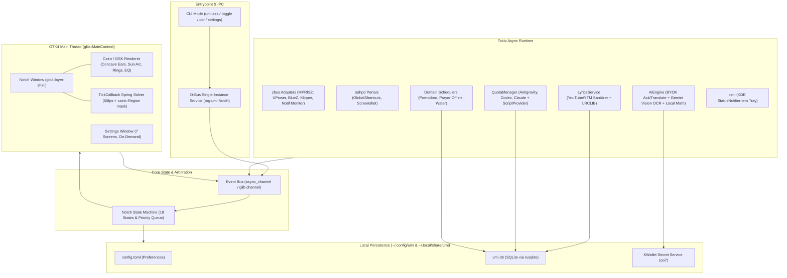
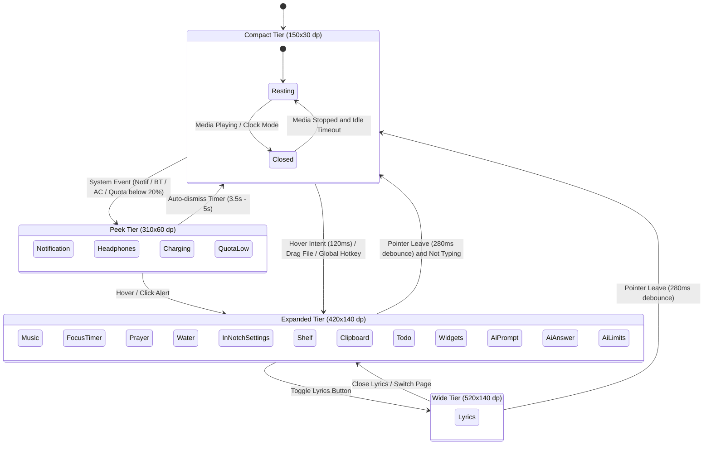

# Architecture Blueprint — UMI Dynamic Island (Pure Rust)

**Versi:** 1.0  
**Tanggal:** 26 November 2026  
**Target Platform:** Fedora Linux 44 — KDE Plasma 6.8+ (Wayland / KWin)  
**Dokumen Terkait:** [PRD.md](./PRD.md) · [design.figcraft](../design.figcraft)

---

## 1. Prinsip Arsitektur

1. **Single Binary, Multi-Window:** Satu executable `umi` mengelola *Notch layer-shell window*, *Settings window* (dibuat *on-demand* lalu dihancurkan saat ditutup agar RAM tetap hemat), ikon System Tray (`StatusNotifierItem`), dan endpoint CLI/D-Bus IPC (`org.umi.Notch`).
2. **Strict Thread Separation (UI vs Async I/O):** Seluruh rendering GTK4/Cairo/Wayland berjalan di **Main Thread (`glib::MainContext`)**. Seluruh pekerjaan I/O (D-Bus watchers, HTTP LRCLIB/AI/OCR, polling kuota AI, PipeWire, SQLite) berjalan di **Tokio multi-thread runtime** dan berkomunikasi lewat kanal pesan satu arah (*unidirectional data flow*).
3. **Wayland-Native, Zero Unsafe Hooks:** Menggunakan `zwlr_layer_shell_v1` (`gtk4-layer-shell`), XDG Desktop Portals (`ashpd`), D-Bus (`zbus`), dan KWallet (`oo7`) — tanpa keylogger `/dev/input` dan tanpa `root`.
4. **Trait-First Modularity:** Subsistem OS (`MediaBackend`, `SystemEvents`, `SecretStore`) dan AI (`AiProvider`, `QuotaProvider`) dipisahkan di balik Rust *traits* sehingga mudah diuji (*mockable*) dan siap di-port ke platform lain di masa depan.

---

## 2. Diagram Arsitektur Sistem



---

## 3. Struktur Proyek Cargo & Modul Rust

```text
UMI/
├── Cargo.toml
├── build.rs                      # Kompilasi CSS/ikon GResource & metadata versi
├── assets/
│   ├── icons/                    # SVG/PNG logo UMI Tapered Notch (18–256px)
│   └── styles/
│       ├── notch.css             # Token warna, radius, shadow & glass mode
│       └── settings.css          # Gaya 7 screen Settings & sidebar badge warna-warni
├── document/
│   ├── PRD.md
│   └── architecture.md
└── src/
    ├── main.rs                   # Bootstrap single-instance, Tokio runtime & GTK4 app
    ├── cli.rs                    # Argumen CLI (umi, umi toggle, umi ask, umi ocr, umi settings)
    ├── ipc.rs                    # D-Bus server/client org.umi.Notch (zbus)
    ├── config/
    │   ├── mod.rs                # Load/save/watch ~/.config/umi/config.toml
    │   └── schema.rs             # Struct UmiConfig (Appearance, Pages, Focus, Water, Prayer, AI)
    ├── state/
    │   ├── mod.rs                # AppState, UiCommand, SystemEvent enums
    │   ├── machine.rs            # State machine 18 state, tier sizing & priority arbitration
    │   └── spring.rs             # Damped spring physics solver (Snappy/Balanced/Calm)
    ├── ui/
    │   ├── mod.rs
    │   ├── notch/
    │   │   ├── window.rs         # Setup gtk4-layer-shell, monitor binding, input region mask
    │   │   ├── shell.rs          # Shared header (.l-hdr), pager arrows, 7-dot bar, concave ears
    │   │   ├── compact.rs        # 01 Resting (mascot eyes/blink) & 02 Closed
    │   │   ├── peek.rs           # 03 Notif, 04 Headphones, 05 Charging, 18 QuotaLow
    │   │   ├── music.rs          # 06 Music & 08 Lyrics (Wide split-pane)
    │   │   ├── focus.rs          # 07 Focus Timer + 8-segment Cairo timeline
    │   │   ├── prayer.rs         # 09 Prayer + Sun Arc Cairo canvas
    │   │   ├── water.rs          # 10 Water + hourly bar chart + In-Notch Water Settings
    │   │   ├── shelf.rs          # 11 Shelf (GTK4 DropTarget/DragSource) & 12 Clipboard
    │   │   ├── todo.rs           # 13 To-do + inline input
    │   │   ├── widgets.rs        # 14 Widgets (This Week, Battery, Weather, etc.)
    │   │   ├── ai.rs             # 15 Ask UMI AI Prompt & 16 Answer/Translate
    │   │   └── limits.rs         # 17 AI Limits (Antigravity, Codex, Claude cards)
    │   ├── settings/
    │   │   ├── window.rs         # Window 860×604, custom titlebar (UMI logo + — □ ×), colorful sidebar
    │   │   ├── general.rs        # Screen 01 + Live Notch Preview widget
    │   │   ├── appearance.rs     # Screen 02 (Style visual cards, Aura swatches, blur/scale sliders)
    │   │   ├── pages.rs          # Screen 03 (Drag-reorder list + toggles)
    │   │   ├── focus_water.rs    # Screen 04 (Pomodoro & Hydration controls)
    │   │   ├── prayer.rs         # Screen 05 (5-time preview, location, method, auto-pause)
    │   │   ├── ai_shortcuts.rs   # Screen 06 (API keys, Quota providers, iCal, keycaps)
    │   │   └── about.rs          # Screen 07 (UMI v1.3.1, local data stats, export/reset)
    │   └── tray.rs               # System Tray Quick Menu via ksni (StatusNotifierItem)
    ├── sys/
    │   ├── mod.rs                # OS abstraction traits (MediaBackend, SystemEvents)
    │   ├── mpris.rs              # D-Bus MPRIS2 multi-player monitor & control
    │   ├── upower.rs             # D-Bus UPower battery & AC adapter listener
    │   ├── bluez.rs              # D-Bus BlueZ audio device & battery listener
    │   ├── klipper.rs            # D-Bus org.kde.klipper history + password-hint filter
    │   ├── notifications.rs      # D-Bus BecomeMonitor observer (+ optional Replace Mode)
    │   ├── portals.rs            # ashpd GlobalShortcuts & Screenshot portals
    │   ├── audio_eq.rs           # PipeWire lightweight peak meter / fallback animator
    │   └── fullscreen.rs         # KWin / Wayland fullscreen detection & autostart .desktop
    ├── lyrics/
    │   ├── mod.rs                # LyricsService coordinator & position sync
    │   ├── sanitizer.rs          # Pembersih judul YouTube / YouTube Music / Spotify
    │   ├── lrclib.rs             # HTTP client lrclib.net (/api/get & /api/search)
    │   └── parser.rs             # Parser timestamp [mm:ss.xx] & binary search line index
    ├── ai/
    │   ├── mod.rs                # AiProvider trait + router (Ask, Translate, OCR)
    │   ├── gemini.rs             # Gemini REST client (Text + Vision OCR + Key Verifier)
    │   ├── claude.rs             # Anthropic Messages API client (BYOK)
    │   ├── openai_compat.rs      # OpenAI / OpenRouter / Ollama local client
    │   └── quick_math.rs         # Evaluator ekspresi matematika & konversi kurs lokal
    ├── quota/
    │   ├── mod.rs                # QuotaProvider trait, scheduler & <20% low-quota trigger
    │   ├── antigravity.rs        # Built-in read-only Antigravity quota adapter
    │   ├── codex.rs              # Built-in read-only Codex CLI/session quota adapter
    │   ├── claude.rs             # Built-in read-only Claude session quota adapter
    │   └── script.rs             # Generic ScriptProvider (~/.config/umi/quota-scripts/*.sh)
    ├── domain/
    │   ├── pomodoro.rs           # Pomodoro state machine & 8-segment round calculator
    │   ├── prayer_calc.rs        # Kalkulasi jadwal sholat astronomis offline (Kemenag/MWL/ISNA)
    │   ├── water.rs              # Log harian, agregasi per jam & reminder scheduler
    │   └── calendar.rs           # Parser Google Calendar iCal (.ics) untuk To-do & Widgets
    └── storage/
        ├── mod.rs                # Inisialisasi SQLite & migrasi skema
        ├── db.rs                 # CRUD tasks, water_logs, shelf_items, quota_snapshots, lyrics_cache
        └── secrets.rs            # Wrapper oo7 (KWallet / org.freedesktop.secrets)
```

---

## 4. Pemilihan Crate Rust (`Cargo.toml`)

| Kategori | Crate | Peran |
|---|---|---|
| **UI & Wayland Overlay** | `gtk4`, `gtk4-layer-shell`, `gdk4`, `cairo-rs`, `glib` | Rendering native Wayland, `zwlr_layer_shell_v1`, `cairo::Region` click-through, DnD Shelf, custom vector drawing. |
| **Async & IPC** | `tokio`, `async-channel`, `zbus` | Async runtime, D-Bus client/server (MPRIS2, UPower, BlueZ, Klipper, Notif, IPC). |
| **Wayland Portals & Tray** | `ashpd`, `ksni` | XDG `GlobalShortcuts` & `Screenshot` portal resmi KDE; ikon tray `StatusNotifierItem`. |
| **HTTP & AI** | `reqwest` (`rustls-tls`), `serde`, `serde_json`, `base64` | Klien HTTP aman untuk LRCLIB, Gemini (Text + Vision OCR), Claude, OpenAI/Ollama, MET Norway. |
| **Storage & Secrets** | `rusqlite` (`bundled` atau system), `toml`, `oo7`, `directories` | Config TOML, database lokal SQLite, penyimpanan terenkripsi di KWallet KDE. |
| **Domain Utilities** | `chrono`, `regex`, `icalendar`, `meval` (atau parser lokal) | Waktu & timezone lokal, sanitizer judul YouTube/YTM, parser iCal, Quick Math. |
| **Logging & CLI** | `clap`, `tracing`, `tracing-subscriber`, `thiserror` | Parsing subcommand CLI, logging terstruktur, error handling bersih. |

---

## 5. Wayland Layer-Shell, Concave Ears & Dynamic Input Mask

### 5.1 Konfigurasi Surface (`gtk4-layer-shell`)
Jendela Notch dibuat dengan ukuran kanvas tetap sebesar lebar maksimum tier **Wide** + margin ear & shadow (`~740 × 230 px` pada skala `1.3×`), berlatar transparan penuh (`background: transparent`), lalu dikunci ke tepi atas tengah layar:
- `init_layer_shell(&window)`
- `set_layer(&window, Layer::Overlay)` (dapat diturunkan ke `Layer::Top` saat opsi *Hide in Fullscreen* aktif)
- `set_anchor(&window, Edge::Top, true)` (Left/Right/Bottom `false` → otomatis *centered* horizontal oleh KWin)
- `set_exclusive_zone(&window, -1)` (tidak menggeser panel atau jendela lain)
- `set_keyboard_mode(&window, KeyboardMode::None)` secara default; berubah ke `KeyboardMode::OnDemand` hanya ketika `NotchState` memasuki `AiPrompt`, `AiAnswer` (follow-up), atau `TodoAdd`.

### 5.2 Dynamic Click-Through Input Region
Agar kanvas transparan `740 × 230 px` tidak memblokir klik pada tab browser atau menu bar aplikasi di belakangnya:
1. Pada setiap tick animasi spring (`widget.add_tick_callback`), `SpringState` menghitung `(current_w, current_h, current_ear)` dalam koordinat lokal kanvas.
2. Bounding box interaktif dihitung sebagai `RectangleInt { x: center_x - current_w/2 - current_ear, y: 0, width: current_w + 2*current_ear, height: current_h }`.
3. `surface.set_input_region(&cairo::Region::create_rectangle(&rect))` diterapkan ke `gdk4::Surface`. Di luar persegi tersebut, KWin meneruskan seluruh klik dan scroll langsung ke jendela di belakang UMI.
4. Saat user men-drag file mendekati tepi atas layar (`DropTarget::enter`), Notch otomatis bertransisi ke `Expanded(Shelf)` sehingga target drop melebar menjadi `546 × 182 px`.

### 5.3 Rendering Concave Ears & Custom Graphics (Cairo)
- **Concave Quarter-Circle Ears:** Digambar via `gtk4::DrawingArea` / `Snapshot::append_cairo` tepat di sisi kiri (`x - ear`) dan kanan (`x + width`) body notch dengan warna `#000000` (atau warna glass surface) sehingga menyatu mulus dengan tepi atas monitor.
- **Custom Canvas Widgets:** Sun Arc (`Prayer`), 8-segment glowing timeline (`Focus Timer`), progress rings (`Battery`, `Headphones`, `Charging`, `QuotaLow`), hourly bars (`Water`), dan live 5-bar EQ digambar langsung via Cairo/GSK untuk ketajaman penuh di fractional DPI.

---

## 6. State Machine & Priority Arbitration



### Aturan Prioritas Event
1. **Interactive Lock (Tertinggi):** Jika pengguna sedang mengetik di `Ask UMI AI` (`AiPrompt`), `TodoAdd`, atau men-drag file ke `Shelf`, auto-collapse ditahan sampai aksi selesai atau menekan `Esc`.
2. **Peek Queue:** Event sistem (`Charging`, `Headphones`, `Notification`, `QuotaLow`) masuk ke antrean FIFO ringan; jika notch sedang `Expanded`, alert ditampilkan sebagai toast/badge halus tanpa memaksa menutup halaman aktif pengguna.
3. **Global Shortcuts (`ashpd` / CLI):** `Ctrl+Alt+Space` langsung membuka `Expanded(AiPrompt)` dan mengaktifkan `KeyboardMode::OnDemand`; `Ctrl+Alt+T` memicu Screenshot Portal lalu langsung membuka `Expanded(AiAnswer)` dengan status loading OCR.

---

## 7. Kontrak Trait & Desain Modul Inti

### 7.1 `QuotaProvider` & `ScriptProvider` (`src/quota/`)

```rust
#[derive(Debug, Clone, Serialize, Deserialize)]
pub enum QuotaStatus {
    Ok,
    Low,          // remaining_pct < threshold (default 20%)
    Exhausted,
    Unavailable,
}

#[derive(Debug, Clone, Serialize, Deserialize)]
pub struct QuotaSnapshot {
    pub provider_id: String,       // "antigravity" | "codex" | "claude" | custom
    pub display_name: String,
    pub plan_label: String,        // mis. "Pro · 5h window"
    pub remaining_pct: u8,         // 0..=100
    pub resets_in_sec: Option<u64>,
    pub status: QuotaStatus,
    pub accent_hex: String,        // "#38BDF8" | "#10B981" | "#F59E0B"
    pub updated_at: i64,
}

#[async_trait::async_trait]
pub trait QuotaProvider: Send + Sync {
    fn id(&self) -> &str;
    async fn fetch(&self) -> anyhow::Result<QuotaSnapshot>;
}
```

- **Built-in Read-Only Adapters:** `AntigravityAdapter`, `CodexAdapter`, dan `ClaudeAdapter` membaca metadata penggunaan / status sesi lokal secara *read-only* (tanpa memodifikasi file atau kredensial milik tool eksternal). Jika sumber lokal tidak ditemukan, adapter mengembalikan `QuotaStatus::Unavailable` dengan aman.
- **Generic `ScriptProvider`:** Memindai skrip executable di `~/.config/umi/quota-scripts/*.sh`, mengeksekusinya dengan `tokio::time::timeout(Duration::from_secs(3))`, dan mem-parse JSON stdout:
  ```json
  {
    "provider": "claude",
    "display_name": "Claude",
    "plan": "Max · Session",
    "remaining_pct": 18,
    "resets_in_sec": 2880,
    "status": "low"
  }
  ```
- **Low-Quota Trigger:** Saat `remaining_pct < config.ai_limits.low_threshold_pct` (default `20%`) dan belum pernah diperingatkan pada siklus reset yang sama, `QuotaManager` memancarkan `SystemEvent::QuotaLow(snapshot)` untuk memicu `Notch 18`.

### 7.2 `AiProvider`, Quick Math & Gemini Vision Smart OCR (`src/ai/`)

```rust
#[async_trait::async_trait]
pub trait AiProvider: Send + Sync {
    fn id(&self) -> &str;
    async fn ask(&self, prompt: &str, system_hint: Option<&str>) -> anyhow::Result<AiResponse>;
    async fn translate(&self, text: &str, target_lang: &str) -> anyhow::Result<AiResponse>;
    async fn ocr_image(&self, png_bytes: &[u8]) -> anyhow::Result<AiResponse>;
    async fn verify_key(&self) -> anyhow::Result<bool>;
}
```

- **Alur `Ask UMI AI`:**
  1. Sebelum memanggil jaringan, `quick_math::try_eval(input)` memeriksa apakah input diakhiri `=` (contoh: `(125*4)/2=` atau `100usd to idr=`). Jika cocok, hasil dihitung secara lokal instan (`< 1ms`) tanpa memakan kuota AI.
  2. Jika prompt biasa, `AiEngine` memilih provider aktif (Gemini default, atau Claude / OpenAI-compatible / Ollama lokal) dengan API key yang diambil dari KWallet (`oo7`) dan menyimpan riwayat sesi terakhir di memori.
- **Alur `Smart OCR` (`Ctrl + Alt + T`):**
  1. `ashpd::desktop::screenshot::Screenshot::request()` membuka selector screenshot native KDE.
  2. File PNG hasil portal dibaca ke memori (lalu file temp dibersihkan), di-encode Base64, dan dikirim ke `GeminiProvider::ocr_image()`.
  3. Respons ditampilkan di `Notch 16 (AiAnswer)` dan otomatis disalin ke clipboard Wayland.

### 7.3 `LyricsService` — Spotify, YouTube & YouTube Music (`src/lyrics/`)
1. **MPRIS2 Watcher (`sys/mpris.rs`):** Memantau perubahan `Metadata` (`xesam:title`, `xesam:artist`, `xesam:album`, `mpris:length`, `mpris:artUrl`) dari player aktif (Spotify, browser Chrome/Firefox/Brave yang memutar YouTube / YouTube Music, maupun player desktop lain).
2. **Title Sanitizer (`lyrics/sanitizer.rs`):**
   - Menghapus sufiks saluran YouTube Music (`- Topic`, `VEVO`).
   - Menghapus tag video (`(Official Video)`, `[Official Music Video]`, `(Lyrics)`, `(Audio)`, `[HD/4K]`, `| ...`).
   - Jika `artist` kosong atau nama channel umum dan judul berpola `"Artist - Song Title"`, memecah otomatis menjadi `(artist, title)`.
3. **LRCLIB Lookup & Cache:**
   - Cek `lyrics_cache` di SQLite berdasarkan kunci ternormalisasi `(artist_norm, title_norm)`.
   - Jika *cache miss*, panggil `GET https://lrclib.net/api/get?track_name=...&artist_name=...&duration=...`; jika 404, fallback `GET https://lrclib.net/api/search?q=...` lalu pilih kandidat dengan `syncedLyrics != null` dan selisih durasi terkecil (`<= 5s`).
   - Simpan hasil ke SQLite agar pemutaran berikutnya instan & offline.
4. **Sync Loop:** Saat `Notch 08 (Lyrics)` terbuka dan `PlaybackStatus == Playing`, timer `100ms` menginterpolasi `mpris_position + elapsed` lalu melakukan *binary search* pada array timestamp LRC untuk menyorot baris aktif secara halus.

---

## 8. Skema Penyimpanan Lokal & Keamanan

### 8.1 Direktori XDG
- **Config:** `~/.config/umi/config.toml` (format TOML, dapat diekspor/impor sebagai JSON melalui `Settings -> About & Data`).
- **Quota Scripts:** `~/.config/umi/quota-scripts/` (opsional, skrip kustom milik pengguna).
- **Database & Cache:** `~/.local/share/umi/umi.db` (SQLite WAL mode) dan `~/.cache/umi/art/` (cache thumbnail album art MPRIS2).
- **Autostart:** `~/.config/autostart/umi.desktop` (dikelola oleh toggle `Start at Login`).

### 8.2 Skema SQLite (`umi.db`)

```sql
CREATE TABLE tasks (
    id          INTEGER PRIMARY KEY AUTOINCREMENT,
    title       TEXT NOT NULL,
    completed   INTEGER NOT NULL DEFAULT 0,
    due_at      INTEGER,               -- Unix timestamp (opsional)
    source      TEXT NOT NULL DEFAULT 'local', -- 'local' | 'ical'
    created_at  INTEGER NOT NULL
);

CREATE TABLE water_logs (
    id          INTEGER PRIMARY KEY AUTOINCREMENT,
    amount_ml   INTEGER NOT NULL,
    logged_at   INTEGER NOT NULL       -- Unix timestamp (diagregasi per jam & hari)
);

CREATE TABLE shelf_items (
    id          INTEGER PRIMARY KEY AUTOINCREMENT,
    uri         TEXT NOT NULL UNIQUE,  -- file:///...
    name        TEXT NOT NULL,
    size_bytes  INTEGER NOT NULL,
    mime_type   TEXT,
    added_at    INTEGER NOT NULL
);

CREATE TABLE quota_snapshots (
    provider_id   TEXT PRIMARY KEY,
    display_name  TEXT NOT NULL,
    plan_label    TEXT NOT NULL,
    remaining_pct INTEGER NOT NULL,
    resets_in_sec INTEGER,
    status        TEXT NOT NULL,
    accent_hex    TEXT NOT NULL,
    updated_at    INTEGER NOT NULL
);

CREATE TABLE lyrics_cache (
    cache_key     TEXT PRIMARY KEY,    -- normalized "artist::title"
    synced_lrc    TEXT,
    plain_lyrics  TEXT,
    duration_sec  INTEGER,
    fetched_at    INTEGER NOT NULL
);
```

### 8.3 Keamanan & Privasi
- **API Keys di KWallet (`oo7`):** `config.toml` hanya menyimpan nama provider aktif dan status konfigurasi — **tidak pernah** menyimpan API key plain-text. Key disimpan di KDE Wallet di bawah atribut `application = "umi"`, `key_type = "gemini_api_key" | "claude_api_key" | "openai_api_key"`.
- **Clipboard Safety:** Listener Klipper otomatis mengabaikan entri yang memiliki MIME/hint password manager (`x-kde-passwordManagerHint` atau `application/x-kde-passwordManagerHint`).
- **Process Sandboxing untuk `ScriptProvider`:** Skrip kuota dijalankan tanpa shell interpolation (`Command::new`), timeout `3s`, dan output dibatasi maksimum `64 KB`.

---

## 9. Prasyarat Build Fedora 44 & Strategi Pengujian

### 9.1 Prasyarat Build (Fedora 44 KDE)
Karena `rustc`/`cargo` belum terpasang di `PATH` saat audit lingkungan, siapkan toolchain terlebih dahulu:
```bash
# 1. Install Rust toolchain via rustup
curl --proto '=https' --tlsv1.2 -sSf https://sh.rustup.rs | sh

# 2. Install development headers Fedora 44 untuk gtk4-rs, layer-shell & SQLite
sudo dnf install -y \
  gtk4-devel \
  gtk4-layer-shell-devel \
  sqlite-devel \
  openssl-devel \
  dbus-devel \
  pkgconf-pkg-config \
  gcc
```

### 9.2 Strategi Pengujian
1. **Unit Tests (`cargo test`):**
   - `state::spring`: konvergensi damped spring tanpa overshoot berlebih di preset `Snappy/Balanced/Calm`.
   - `state::machine`: transisi 18 state, prioritas Peek queue, dan lock saat mengetik.
   - `lyrics::sanitizer` & `lyrics::parser`: uji puluhan variasi judul YouTube/YouTube Music/Spotify dan akurasi binary search timestamp LRC.
   - `domain::prayer_calc`: validasi hasil jadwal sholat offline (Bandung/Jakarta, Kemenag RI) terhadap tabel resmi (`toleransi <= 1 menit`).
   - `quota::script` & `ai::quick_math`: uji parsing JSON valid/malformed/timeout dan evaluasi ekspresi matematika/kurs.
2. **Integration & Wayland Verification (Manual di Fedora 44 KDE):**
   - Uji *click-through* pada area transparan di kiri/kanan notch saat membuka browser maximised.
   - Uji drag-in & drag-out `Shelf` antara Dolphin dan browser.
   - Uji `Lyrics` real-time pada Spotify dan tab YouTube Music di browser.
   - Uji `Ctrl+Alt+Space` (`Ask UMI AI`), `Ctrl+Alt+T` (`Gemini Vision OCR`), multi-monitor, sleep/wake, dan aplikasi video fullscreen.
